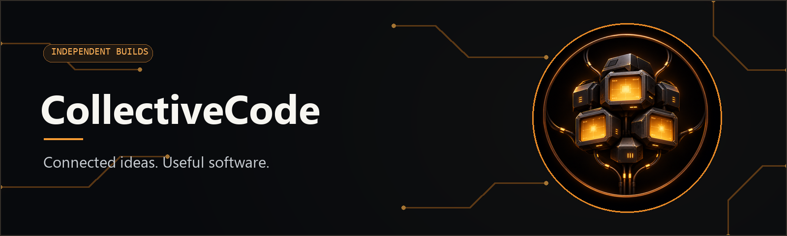

  

  <h1>CollectiveCode</h1>
  
<strong>Connected ideas. Useful software.</strong>

  
I’m Mitchell. I build tools, interfaces, and working prototypes that turn messy workflows into something people can use.

---

### Built for the work in front of us

| Project | What it does | Explore |
| --- | --- | --- |
| **Joblio** | A Windows job tracker for sign shops, built around the path from new job to installation or collection. | [Repository](https://github.com/MitchellPel/Joblio) · [Download](https://github.com/MitchellPel/Joblio/releases/latest) |
| **3D Works client prototype** | A browser prototype for requesting a 3D print, previewing a model, and following a sample job. Data stays in the browser. | [Repository](https://github.com/MitchellPel/3d-works-prototype) · [Live prototype](https://mitchellpel.github.io/3d-works-prototype/) |
| **3D Works** | A smaller browser demo for uploading an STL or OBJ, reviewing a part, and moving sample jobs across a shop board. | [Repository](https://github.com/MitchellPel/3d-works) |

 

One collective identity for independent builds. Each project has its own purpose and stage of development.
